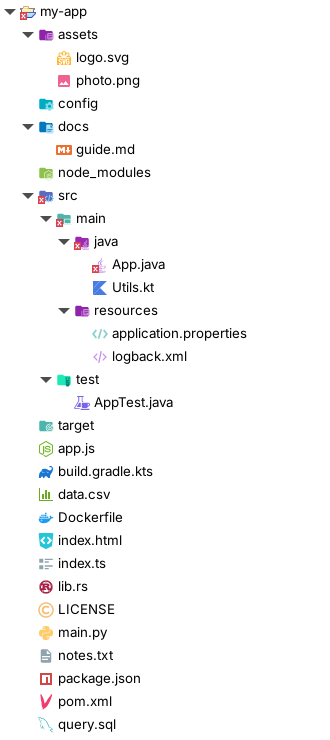
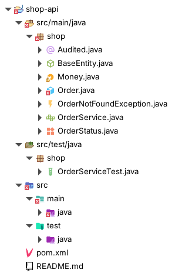
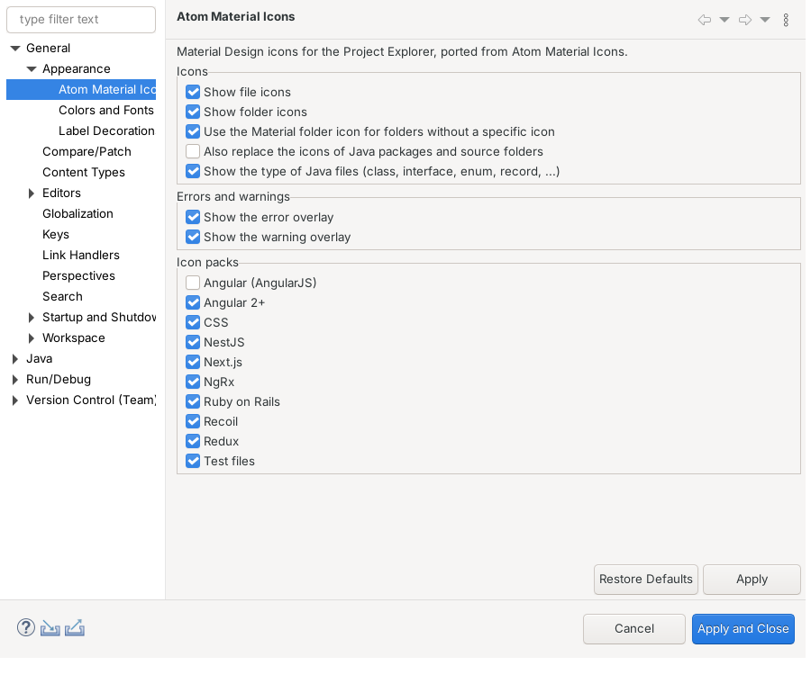

# Atom Material Icons for Eclipse

An Eclipse port of the [Atom Material Icons](https://github.com/mallowigi/a-file-icon-idea)
IntelliJ plugin. It replaces the file and folder icons in the **Project Explorer** with
Material Design icons chosen by file name, extension and folder name.



## Features

- **1,700+ file icons and 350+ folder icons** from Atom Material Icons, picked with the same
  rules as the IntelliJ plugin (regular expressions with priorities, matched on the name or path).
- Works with the **Project Explorer**, including Java projects (`.java` files, `pom.xml`,
  `build.gradle.kts`, ...).
- **Java type icons** like IntelliJ IDEA: with JDT installed, a `.java` file shows the kind of type
  it declares — class, abstract class, interface, enum, record, annotation, exception, or test class
  (in test source folders). The icon updates when the file is saved.
- **Clear error/warning overlays**: the standard Eclipse problem overlays are drawn with a
  transparent margin, so they stand out on the colorful icons. Git (EGit) and linked resource
  decorations are still drawn on top of the icons as usual.
- Crisp on **HiDPI** screens (`@2x` icons).
- **Preferences** under *Window › Preferences › General › Appearance › Atom Material Icons*:
  - toggle file icons, folder icons and the generic Material folder icon,
  - optionally replace the icons of Java packages and source folders as well,
  - toggle the Java type icons,
  - toggle problem overlays,
  - enable or disable the optional icon packs (Angular, NestJS, Redux, Rails, test files, ...).
- The icons can also be switched off per view via *Project Explorer › ⋮ › Customize View… › Content ›
  Atom Material Icons*.



> **Tip:** JDT's *Java Type Indicator* decorator adds small `I`/`A` badges to interfaces and
> abstract classes, which is redundant with the type icons. Turn it off in
> *Window › Preferences › General › Appearance › Label Decorations › Java Type Indicator*.



## Requirements

- Eclipse 2024-03 (4.31) or newer
- Java 17 or newer

## Installation

1. Build the update site (see below) or download the `atom-material-icons-update-site` artifact
   of the latest successful [GitHub Actions build](../../actions/workflows/build.yml) and unzip it.
2. In Eclipse open *Help › Install New Software… › Add… › Local…* and select the
   `releng/io.github.socra167.atommaterialicons.site/target/repository` folder
   (or the unzipped artifact).
3. Select **Atom Material Icons**, finish the wizard and restart Eclipse.

## Building

```sh
mvn clean verify
```

The build uses [Eclipse Tycho](https://github.com/eclipse-tycho/tycho) and needs Maven 3.9 and
Java 17+. The UI tests open a real workbench, so on a headless Linux machine run them with
`xvfb-run mvn clean verify`.

| Module | Content |
| --- | --- |
| `bundles/io.github.socra167.atommaterialicons` | The plug-in: icons, associations, Project Explorer integration and preferences |
| `tests/io.github.socra167.atommaterialicons.tests` | Unit tests of the icon association engine |
| `tests/io.github.socra167.atommaterialicons.uitests` | UI tests against a running Project Explorer |
| `features/io.github.socra167.atommaterialicons.feature` | Installable feature |
| `releng/io.github.socra167.atommaterialicons.site` | p2 update site |
| `tools/icon-generator` | Converts the upstream SVG icons and associations |

## Updating the icons

The PNG icons and the association files in the plug-in are generated from the
[Atom Material Icons icon generator](https://github.com/AtomMaterialUI/iconGenerator):

```sh
git clone --depth 1 https://github.com/AtomMaterialUI/iconGenerator.git /tmp/iconGenerator
git clone --depth 1 https://github.com/mallowigi/a-file-icon-idea.git /tmp/a-file-icon-idea
cd tools/icon-generator
npm install
node generate.mjs /tmp/iconGenerator --java /tmp/a-file-icon-idea
```

The script renders every referenced SVG to a 16×16 PNG and a 32×32 `@2x` PNG and writes
`associations/files.xml` and `associations/folders.xml`, recording the upstream revision.
With `--java` it also renders the Java type icons from the glyphs of the IntelliJ plugin.

## How it works

Eclipse's Project Explorer does not let decorators replace icons, so the plug-in contributes a
label-only *navigator content* with the highest priority. The Common Navigator asks its label
provider for an image first; when it finds an icon it returns it, otherwise it returns nothing and
the regular resource/Java label providers are used. Workbench decorators are then applied to the
result as usual.

## 한국어 안내

IntelliJ용 **Atom Material Icons** 플러그인을 Eclipse로 옮긴 확장입니다. Project Explorer에서
파일 확장자, 파일 이름, 폴더 이름에 따라 Material Design 아이콘을 보여 줍니다.

- 설치: 위 *Installation* 절차대로 빌드된 업데이트 사이트를 *Help › Install New Software…*에서 추가합니다.
- Java 파일은 IntelliJ처럼 선언된 타입(클래스, 추상 클래스, 인터페이스, enum, record, 어노테이션,
  예외, 테스트 클래스)에 따라 다른 아이콘으로 표시됩니다. JDT가 설치되어 있어야 합니다.
- 오류/경고는 Eclipse 기본 오버레이를 쓰되, 아이콘 위에서 잘 보이도록 주변을 투명하게 비워 표시합니다.
- JDT의 *Java Type Indicator*(인터페이스 `I`, 추상 클래스 `A` 배지)는 타입 아이콘과 중복되므로
  *General › Appearance › Label Decorations*에서 끄는 것을 권장합니다.
- 설정: *Window › Preferences › General › Appearance › Atom Material Icons*에서 파일/폴더 아이콘,
  Java 타입 아이콘, Java 패키지 아이콘 교체, 오류 오버레이, 아이콘 팩을 켜고 끌 수 있습니다.

## License

MIT. The icons and icon associations come from Atom Material Icons by Elior "Mallowigi"
Boukhobza, also under the MIT License. See [LICENSE](LICENSE).
